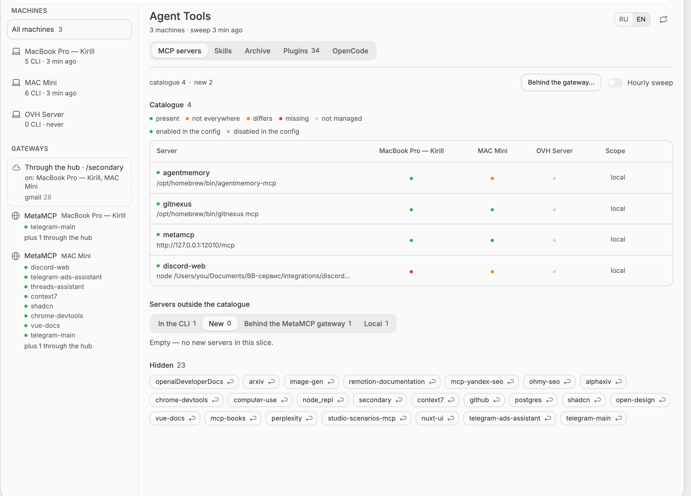

# Agent Tools for BB

Agent Tools is a BB plugin for comparing MCP servers, CLI plugins, OpenCode providers, and agent skills across connected machines. It keeps an editable MCP catalogue and a skills canon, with explicit operations to sync changes.



## Install

In BB, search the plugin marketplace for **Agent Tools**. To install from source:

```sh
git clone https://github.com/VKirill/bb-plugin-agent-tools.git
cd bb-plugin-agent-tools
npm ci
bb plugin build .
bb plugin install .
```

Open the **Agent Tools** page in the BB sidebar. The interface and CLI support Russian and English; the page follows BB’s interface language, and the CLI language is set with `bb tools lang ru|en`.

## Documentation

- [Overview](docs/overview.md) and [architecture](docs/architecture.md)
- Features: [MCP catalogue](docs/features/mcp-catalog.md), [skills](docs/features/skills.md), [CLI plugins](docs/features/cli-plugins.md), and [OpenCode](docs/features/opencode.md)
- [API and commands](docs/api.md), [deployment](docs/deployment.md), [data model](docs/data-model.md), and [gotchas](docs/gotchas.md)
- [Release notes](CHANGELOG.md)
