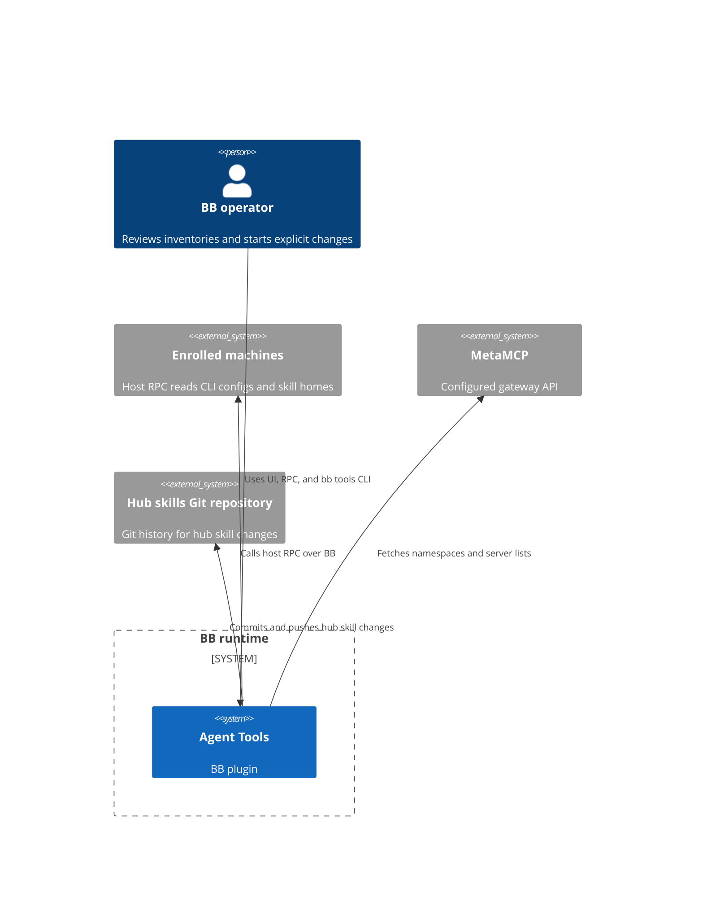
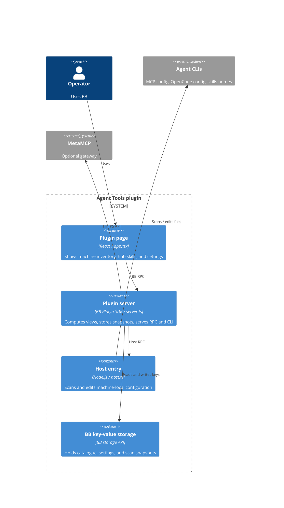
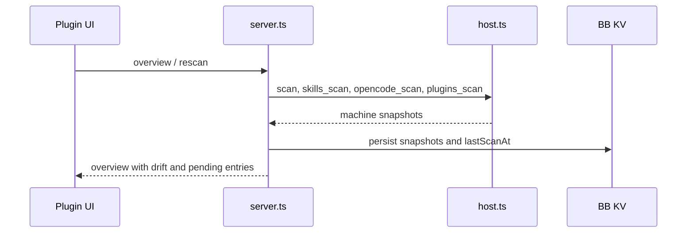
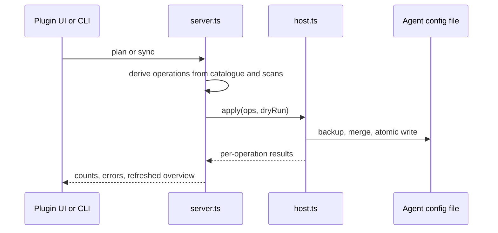

# Agent Tools architecture
The server coordinates BB UI/CLI requests, host RPC calls, local configuration changes, and stored scan snapshots (`server.ts:479-525`, `host.ts:783-785`).

## System context

A BB operator uses the plugin UI or `bb tools`; the plugin calls host RPC for connected machine data, reads BB provider/model metadata for the skill classifier, and can query a configured MetaMCP gateway (`server.ts:492-561`, `server.ts:603-648`, `server.ts:985-1013`).



Diagram evidence: plugin entry points and host client (`server.ts:484-561`); host entry (`host.ts:783-785`); MetaMCP settings and fetch flow (`server.ts:492-511`, `server.ts:625-639`); hub Git operations (`hub-skills.ts:179-234`); server-process skill directory (`skills-hub-service.ts:263-269`, `skills-server.ts:58-64`).

## Containers



The manifest points BB to `app.tsx`, `server.ts`, and `host.ts` (`package.json:28-38`). The UI calls RPC methods through the server (`app.tsx:115-139`); the server creates a host client and the skills service (`server.ts:545-561`); `SettingsPage` reads and saves classifier and cleanup settings through skills RPC (`settings-page.tsx:37-79`); the host entry performs machine file operations (`host.ts:783-785`, `host.ts:213-241`, `host.ts:1118-1189`).

## Building blocks

- `agents.ts` defines CLI config paths, dialects, providers, and path confirmation (`agents.ts:5-47`, `agents.ts:56-219`).
- `normalize.ts`, `toml-mcp.ts`, `opencode.ts`, and `probe.ts` translate, compare, edit, and check agent configuration (`server.ts:8-19`, `host.ts:14-19`).
- `contract.ts` defines validated server RPC and host RPC methods and data shapes (`contract.ts:355-452`, `server.ts:201-448`).
- `skills.ts` computes skill states and deterministic promotion/fan-out plans (`skills.ts:103-190`, `skills.ts:267-330`, `skills.ts:409-525`).
- `skills-sync.ts` reconciles the canon with its Git remote, adds ignore patterns for link names and dependency/cache directories, and preserves colliding local skill folders during an untracked-file overwrite recovery (`skills-sync.ts:87-232`).
- `skills-server.ts` scans, backs up, copies, and extracts filtered skill trees in the BB server process's `dataDir/skills` (`skills-server.ts:58-64`, `skills-server.ts:66-100`, `skills-server.ts:102-145`); `skill-tree.ts` defines excluded junk and BB tree measurement (`skill-tree.ts:12-29`, `skill-tree.ts:32-70`).
- `server.ts` owns cross-machine orchestration, state, CLI registration, and hourly sweep (`server.ts:479-525`, `server.ts:2045-2278`, `server.ts:2280-2363`).
- `host.ts` owns machine-local scans, backups, and writes (`host.ts:151-241`, `host.ts:374-435`, `host.ts:783-818`, `host.ts:1118-1189`).
- `app.tsx` renders MCP, skills, CLI plugins, OpenCode, and settings sections; `skills-page.tsx` and `settings-page.tsx` provide the hub skill and classifier settings surfaces (`app.tsx:919-941`, `app.tsx:3368-3390`, `app.tsx:3551-3558`, `settings-page.tsx:37-79`). The UI selects language from BB's document locale before rendering translated labels (`app.tsx:114-119`, `app.tsx:325-332`, `i18n.en.ts:4-63`).

## Key flows

### Scan and catalogue view



The scan sequence calls `scan`, `skills_scan`, `opencode_scan`, and `plugins_scan` for each connected target and persists each successful result in its host-keyed snapshot; the main MCP scan also stores a failure string when the host call rejects (`server.ts:592-623`, `server.ts:624-646`).

### Apply MCP sync



The server plans and dispatches changes (`server.ts:1110-1144`, `server.ts:1596-1641`); the host backs up and writes files atomically (`host.ts:213-241`, `host.ts:1118-1189`).

### Hub skill import and cleanup

```mermaid
sequenceDiagram
  participant UI as Plugin UI or CLI
  participant S as server.ts
  participant H as host.ts
  participant K as BB KV
  participant M as Machine skill folders
  participant B as BB server dataDir/skills
  UI->>S: refresh machine skills
  S->>H: skill_homes_count
  H-->>S: counts and newest valid skill per name
  S->>K: store machine summary
  UI->>S: skills_machines_import
  S->>H: skill_pack for each selected missing skill
  H-->>S: archive
  S->>B: validate and publish archive
  S-->>UI: per-skill result; machine source remains
  UI->>S: skills_machines_cleanup (explicit)
  S->>H: skill_homes_cleanup
  H->>M: move folders to dated backup
```

Machine refresh stores home counts and discovered skills; import packs selected skills missing from the hub and publishes each through the same validation path as other machine publishes. Cleanup is a separate host call and moves machine folders to a dated backup (`skills-hub-service.ts:444-475`, `skills-hub-service.ts:593-609`, `skills-hub-service.ts:724-735`, `host-skills.ts:144-163`, `host-skills.ts:167-223`). The hub Git repository records hub skill edits (`hub-skills.ts:179-234`).

## Invariants

- A machine appears in the scan target set only when BB reports it connected (`server.ts:603-612`).
- MCP write eligibility requires an installed, non-gateway, writable agent with an existing config or confirmed path (`server.ts:663-670`).
- A catalogue entry is rolled out only when its scope is `global` and its target list is empty or includes that agent kind (`server.ts:672-675`).
- Failed host scans are retained as error snapshots; skill/OpenCode/plugin scan failures are logged and surfaced through their area state (`server.ts:603-646`).
- Config writes take a backup and use a temporary file followed by rename (`host.ts:213-241`).
- The hourly schedule refreshes machine skill summaries and starts hub classification only when `skillsClassifierAuto` is enabled; it does not fan out skills into machine folders (`server.ts:2302-2312`).

## Cross-cutting concerns

**Validation.** Zod schemas bound RPC inputs and output shapes; `rpcContract` and `hostContract` define the server/host interfaces (`contract.ts:355-452`, `server.ts:201-448`).

**Errors.** Host RPC rejections are recorded on MCP scan snapshots, while writes return per-operation errors; skill bulk actions preserve failures in their response (`server.ts:558-567`, `host.ts:1118-1189`, `server.ts:2120-2150`).

**Language.** UI and CLI strings pass through the shared language functions; the CLI/server language is persisted in BB KV and defaults to English. The UI applies `document.documentElement.lang` (`ru*` → Russian, otherwise English) before storing data and observes locale changes, and computes state labels, hints, and filters during render so they use that selection (`i18n.ts:8-69`, `i18n.en.ts:4-63`, `server.ts:483-485`, `server.ts:2152-2157`, `app.tsx:114-119`, `app.tsx:325-332`, `app.tsx:431-501`).

See [API](api.md), [data model](data-model.md), and the [feature pages](features/mcp-catalog.md).

<!-- lane-pilot:backlinks -->
## Referenced by

- [Agent Tools deployment](deployment.md)
- [CLI plugin inventory](features/cli-plugins.md)
- [Agent Tools overview](overview.md)
