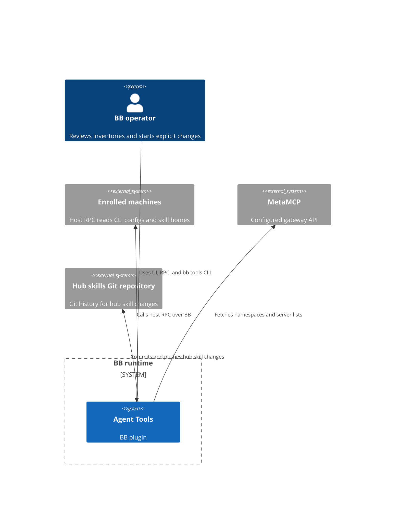
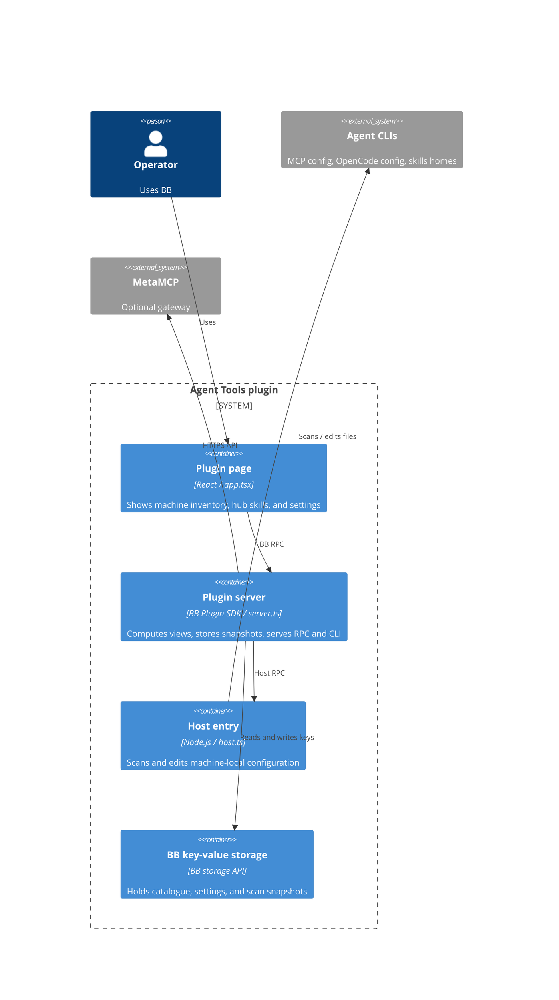
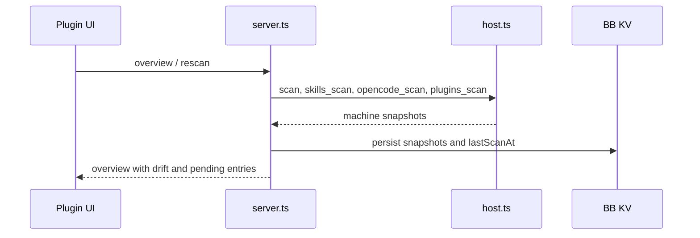
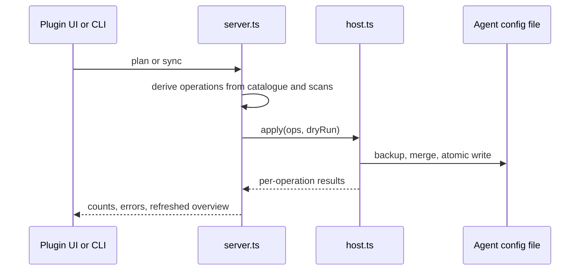

# Agent Tools architecture
The server coordinates BB UI/CLI requests, host RPC calls, local configuration changes, and stored scan snapshots (`server.ts:477-595`, `host.ts:789-826`).

## System context

A BB operator uses the plugin UI or `bb tools`; the plugin calls host RPC for connected machine data, reads BB provider/model metadata for hidden skill threads, and can query a configured MetaMCP gateway (`server.ts:485-609`, `server.ts:651-696`, `server.ts:731-747`).



Diagram evidence: plugin entry points and host client (`server.ts:477-609`); host entry (`host.ts:789-826`); MetaMCP settings and fetch flow (`server.ts:486-504`, `server.ts:731-747`); hub Git operations (`hub-skills.ts:179-234`); server-process skill directory (`skills-hub-service.ts:328-337`, `skills-server.ts:58-64`).

## Containers



The manifest points BB to `app.tsx`, `server.ts`, and `host.ts` (`package.json:25-37`). The UI calls RPC methods through the server (`app.tsx:100-170`); the server creates a host client and the skills service (`server.ts:590-609`); `SettingsPage` reads and saves language, classifier, and experimental hub-only settings through skills RPC and `ui_language_set` (`settings-page.tsx:47-162`, `settings-page.tsx:243-289`); the host entry performs machine file operations (`host.ts:789-826`, `host.ts:228-270`, `host.ts:1102-1178`).

## Building blocks

- `agents.ts` defines CLI config paths, dialects, providers, and path confirmation (`agents.ts:5-47`, `agents.ts:56-219`).
- `normalize.ts`, `toml-mcp.ts`, `opencode.ts`, and `probe.ts` translate, compare, edit, and check agent configuration (`server.ts:8-22`, `host.ts:14-19`).
- `contract.ts` defines validated host RPC methods and shared schemas, while `server.ts` builds `rpcContract` (`contract.ts:359-498`, `server.ts:219-450`).
- `skills.ts` computes legacy skill states and deterministic promotion/fan-out plans (`skills.ts:103-190`, `skills.ts:267-330`, `skills.ts:409-525`).
- `skills-sync.ts` provides `execFileOutput`, `runGit` (forcing `core.autocrlf=false` and `LC_ALL`/`LC_MESSAGES`/`LANG`/`LANGUAGE="C"`), and `resolveGitBin` for hub Git/archive calls and host Git callers (`skills-sync.ts:14-69`, `hub-skills.ts:5`, `host.ts:18`).
- `hub-only.ts` implements `loadableHubNames`, `machineNotOnHub`, and `enforceHubOnly` for hub-only skill enforcement (`hub-only.ts:46-126`).
- `required-session-policy.ts` constructs `experimental_vkRequiredSessionPolicy` payloads so hidden classifier and card-writer threads stay scoped (`required-session-policy.ts:73-103`, `skills-hub-service.ts:404-408`).
- `skills-server.ts` scans, backs up, copies, and extracts filtered skill trees in the BB server process's `dataDir/skills` (`skills-server.ts:58-64`, `skills-server.ts:66-100`, `skills-server.ts:102-145`); `skill-tree.ts` defines excluded junk and BB tree measurement (`skill-tree.ts:12-29`, `skill-tree.ts:32-70`).
- `server.ts` owns cross-machine orchestration, state, CLI registration, and hourly sweep (`server.ts:477-595`, `server.ts:2043-2275`, `server.ts:2350-2954`).
- `host.ts` owns machine-local scans, backups, and writes (`host.ts:158-270`, `host.ts:381-442`, `host.ts:789-826`, `host.ts:1102-1178`).
- `app.tsx` renders MCP, skills, CLI plugins, OpenCode, and settings sections; `skills-page.tsx` and `settings-page.tsx` provide the hub skill and settings surfaces (`app.tsx:900-960`, `app.tsx:3520-3580`, `settings-page.tsx:47-289`).

## Key flows

### Scan and catalogue view



The scan sequence calls `scan`, `skills_scan`, `opencode_scan`, and `plugins_scan` for each connected target and persists each successful result in its host-keyed snapshot; the main MCP scan also stores a failure string when the host call rejects (`server.ts:640-696`).

### Apply MCP sync



The server plans and dispatches changes (`server.ts:1202-1241`, `server.ts:1594-1642`); the host backs up and writes files atomically (`host.ts:228-270`, `host.ts:1102-1178`).

### Hub skill import and cleanup

```mermaid
sequenceDiagram
  participant UI as Plugin UI or CLI
  participant S as server.ts
  participant H as host.ts
  participant K as BB KV
  participant M as Machine skill folders
  participant B as BB server dataDir/skills
  UI->>S: refresh machine skills
  S->>H: skill_homes_count(protect)
  H-->>S: counts and newest valid skill per name
  S->>K: store machine summary
  UI->>S: skills_machines_import
  S->>H: skill_pack for each selected missing skill
  H-->>S: archive
  S->>B: validate and publish archive
  S-->>UI: per-skill result; machine source remains
  UI->>S: skills_machines_cleanup (or hubOnly sweep)
  S->>H: skill_homes_cleanup(dryRun, protect)
  H->>M: move folders to dated backup
```

Machine refresh passes `protectPaths()` (token `.agent-tools-canon`) and stores home counts and discovered skills; import packs selected skills absent from `loadableHubNames(hub)` and publishes each through the same validation path as other machine publishes. Cleanup moves machine folders to a dated backup, either explicitly or via `enforceHubOnly` when `skillsHubOnly` is enabled (`skills-hub-service.ts:927-1041`, `skills-hub-service.ts:1163-1179`, `skills-hub-service.ts:1309-1325`, `host-skills.ts:113-259`, `hub-only.ts:46-126`). The hub Git repository records hub skill edits (`hub-skills.ts:179-234`).

## Invariants

- A machine appears in the scan target set only when BB reports it connected (`server.ts:651-696`).
- MCP write eligibility requires an installed, non-gateway, writable agent with an existing config or confirmed path (`server.ts:755-762`).
- A catalogue entry is rolled out only when its scope is `global` and its target list is empty or includes that agent kind (`server.ts:764-767`).
- Failed host scans are retained as error snapshots; skill/OpenCode/plugin scan failures are logged and surfaced through their area state (`server.ts:640-696`).
- Config writes take a backup and use a temporary file followed by rename (`host.ts:228-270`).
- Hub-only enforcement skips machine cleanup whenever any missing skill hits a blocking BB validation problem or transient import error (`hub-only.ts:63-118`).
- The hourly sweep refreshes machine skill summaries, runs `enforceHubOnly` only when `skillsHubOnly` is enabled, and starts hub classification only when `skillsClassifierAuto` is enabled (`server.ts:2256-2270`).

## Cross-cutting concerns

**Validation.** Zod schemas bound RPC inputs and output shapes; `rpcContract` and `hostContract` define the server/host interfaces (`contract.ts:359-498`, `server.ts:219-450`).

**Errors.** Host RPC rejections are recorded on MCP scan snapshots, while writes return per-operation errors; skill bulk actions preserve failures in their response (`server.ts:640-650`, `host.ts:1102-1178`, `server.ts:2119-2150`).

**Language.** CLI and server strings pass through `t` and `tp` (`i18n.ts:31-51`) plus `plural` (`i18n.ts:150-160`), while `setLang` and `set_language` read and update KV `"lang"` (defaulting to English) (`server.ts:479-484`, `server.ts:2151-2156`). Page UI strings resolve separately through KV `"uiLang"` (`"auto" | "ru" | "en"`, updated by `ui_language_set`) and `resolveUiLang` / `readUiLangEnv`, which in `"auto"` mode inspects `data-pk-lang`, `localStorage["bb-plugin-ru:enabled"]`, Cyrillic sidebar/header `aria-label` attributes, and `document.documentElement.lang`, then applies `applyUiLang()` and observes DOM changes (`i18n.ts:60-130`, `i18n.en.ts:4-63`, `app.tsx:100-165`, `settings-page.tsx:100-162`, `server.ts:583-586`, `server.ts:2157-2162`).

See [API](api.md), [data model](data-model.md), and the [feature pages](features/mcp-catalog.md).

<!-- lane-pilot:backlinks -->
## Referenced by

- [Agent Tools deployment](deployment.md)
- [CLI plugin inventory](features/cli-plugins.md)
- [Agent Tools overview](overview.md)
