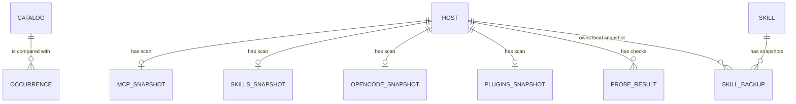
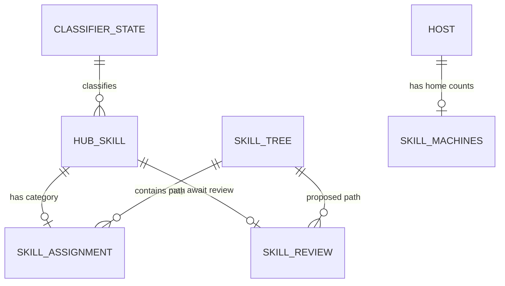

# Agent Tools data model
The plugin stores its catalogue, preferences, probe results, and per-host scan snapshots in BB key-value storage; machine-owned configs and skill archives remain files on their host (`server.ts:619-747`, `host.ts:158-328`).

## Schema overview

The diagram's occurrence entity is computed from scans, not a persisted collection; `hostContract` (`contract.ts:359-498`), stored `Snapshot` entries (`server.ts:448-475`), and `readSnapshots` / feature scan storage (`server.ts:629-729`) hold the persisted inputs.

### Hub skill categories

`HUB_SKILL` is a directory on the BB server, not a KV row. `SKILL_TREE`, `SKILL_ASSIGNMENT`, `SKILL_REVIEW`, `CLASSIFIER_STATE`, `SKILL_MACHINES`, `skillHubOnlyLast`, and `skillCanonToken` are values stored under separate BB KV keys; the ER links show the application relationships, not database foreign keys (`hub-skills.ts:8-12`, `skills-hub-service.ts:306-317`, `skills-hub-service.ts:342-373`).

## BB key-value collections

### Hub skills, categories, and classifier state

The hub library is `<experimental_dataDir>/skills`; the plugin computes each skill's description, byte/file counts, newest modification time, and validation problems by reading the folder (`skills-hub-service.ts:328-337`, `hub-skills.ts:80-105`). The category tree, assignments, review items, classifier state, canon token, hub-only report, and per-host homes summary are independent KV values, defaulting to a seeded tree or empty values when absent (`skills-hub-service.ts:306-317`, `skills-hub-service.ts:342-373`, `skills-hub-service.ts:927-1041`).

| Entity / key | Field or key | Meaning |
|---|---|---|
| `HUB_SKILL` / folder | `name` | Top-level directory name on the BB server; folder-derived listing skips hidden names and non-directories (`hub-skills.ts:96-105`). |
| `HUB_SKILL` / folder | `description`, `bytes`, `files`, `mtime`, `problems` | Parsed description, measured bytes/files, newest file modification time in milliseconds, and BB validation findings computed on read (`hub-skills.ts:15-22`, `hub-skills.ts:80-95`). |
| `skillTree` | `sections[]` | Category tree stored under KV `"skillTree"` (`skills-hub-service.ts:306-310`); `SkillTree` and `SkillSection` define section IDs, titles, descriptions, and `subsections` (`categories.ts:7-20`). |
| `skillTree` | `subsections[]` | `SkillSubsection` child category fields: ID, Russian/English titles, and description (`categories.ts:7-20`); `normalizeKey` and `makeId` derive IDs from normalized titles (`categories.ts:50-71`). |
| `skillAssignments` | `skill` | Hub skill name; one current assignment is maintained per skill by upsert (`categories.ts:25-33`, `categories.ts:194-205`). |
| `skillAssignments` | `sectionId`, `subsectionId` | IDs of the assigned path in `skillTree`; `locate` verifies the path when assembling the view (`categories.ts:25-33`, `categories.ts:96-104`, `skills-hub-service.ts:1044-1086`). |
| `skillAssignments` | `source`, `confidence`, `reason`, `at` | Source is `manual`, `family`, or `model`; confidence and reason may be null; `at` is epoch milliseconds (`categories.ts:22-33`). |
| `skillReview` | `skill`, `section`, `subsection` | Hub skill name and proposed category labels held for a manual decision (`categories.ts:35-42`). |
| `skillReview` | `confidence`, `reason`, `at` | Nullable model confidence/reason and proposal time in epoch milliseconds (`categories.ts:35-42`). |
| `skillClassifier` | `threadId`, `startedAt`, `count`, `running` | Hidden classifier thread ID or null, start time in epoch milliseconds, skills sent in that thread, and persisted run flag (`classifier.ts:37-43`). |
| `skillClassifier` | `lastRunAt`, `lastError`, `lastPlaced` | Last completion time in epoch milliseconds or null, clipped error text or null, and placements in the last run (`classifier.ts:37-56`). |
| `skillMachines` | `hostId`, `hostName`, `homes`, `notOnHub`, `error`, `at` | Host identity; measured home counts; discovered machine skills absent from `loadableHubNames(hub)` (`machineNotOnHub`); per-host error or null; refresh time in epoch milliseconds (`skills-hub-service.ts:962-1000`, `skills-hub-service.ts:1083`, `hub-only.ts:46-57`, `host-skills.ts:186-207`). |
| `skillCanonToken` | string UUID | Persistent random token in KV `"skillCanonToken"` (`KV.canonToken`, `skills-hub-service.ts:313`) read by `canonToken` and written by `stampCanon` to `<root>/.agent-tools-canon` (`skills-hub-service.ts:927-959`), verified by `CANON_MARKER` checks (`host-skills.ts:113-145`). |
| `skillHubOnlyLast` | `at`, `imported`, `moved`, `rejected`, `skipped` | Outcome summary of the latest `enforceHubOnly` sweep or `bb tools skills-hub-only` run (`skills-hub-service.ts:312`, `skills-hub-service.ts:1006-1041`, `hub-only.ts:11-24`). |

The service reads category data together and serializes writes through a promise lock; category tree, assignments, and review are then persisted as three KV writes (`skills-hub-service.ts:342-369`). The UI and CLI can read the assembled hub view; service handlers write assignments, review, tree, hub-only state, and machine summaries (`skills-hub-service.ts:1006-1326`).

The hub folder name is its directory key. Category IDs identify section/subsection nodes; assignment and review `skill` names identify their entries by application convention, while classifier state is the singleton value at `skillClassifier` and machine summaries use host IDs (`hub-skills.ts:96-105`, `categories.ts:50-71`, `categories.ts:194-205`, `skills-hub-service.ts:306-317`, `skills-hub-service.ts:962-1000`).

| Status-like field | From → to | Function and condition |
|---|---|---|
| `skillClassifier.running` | `false` → `true` | `SkillClassifier.runOnce` persists `running: true` at the start of a run (`classifier.ts:223-226`). |
| `skillClassifier.running` | `true` → `false` | `runOnce` writes false after queue completion or after a caught classifier error (`classifier.ts:254-261`). |
| `skillClassifier.running` | persisted `true` → `false` → active run | `createSkillsHubService` detects the stale flag at startup, clears it, then calls `classifier.run()` (`skills-hub-service.ts:464-470`). |
| `skillReview` membership | unplaced → review | Confidence below `CONFIDENCE_FLOOR` (`classifier.ts:141-149`) or two unanswered `TOOL_ASSIGN` attempts (`classifier.ts:285-300`) add a `review` item. |
| `skillReview` membership | review → assignment | `acceptReview` ensures its proposed path, writes a manual assignment, and removes the review item (`skills-hub-service.ts:1112-1131`). |
| `skillAssignments.source` | absent → `family` | `placeByFamily` assigns when the sibling quorum agrees on one existing category (`classifier.ts:176-200`). |
| `skillAssignments.source` | absent or automatic → `model` | `applyModelAssign` stores a validated model placement; existing manual placements are rejected before it runs (`classifier.ts:128-173`, `categories.ts:194-205`). |
| `skillAssignments.source` | any source → `manual` | UI move and review acceptance write manual assignments (`skills-hub-service.ts:1096-1131`). |
| `skillAssignments.source` | `manual` → automatic source | No transition: `upsertAssignment` preserves manual assignments when the next source is `family` or `model` (`categories.ts:194-205`). |

Assignments and review entries for removed hub skills are pruned at the beginning of classification (`classifier.ts:228-238`, `categories.ts:218-221`). The plugin code has no retention or cleanup job for these KV values; removing a hub skill is separate and moves its folder into the hub-side backup archive (`hub-skills.ts:245-259`, `hub-skills.ts:348-357`).

### `catalog` — desired MCP server definitions

Written by adoption and catalogue update/removal/sync commands; read by overview, drift, and plan (`server.ts:619-621`, `server.ts:1880-1900`, `server.ts:2066-2091`).

| Field | Meaning |
|---|---|
| `name` | Server key; non-empty, maximum 120 characters (`contract.ts:503-513`). |
| `spec` | Normalized `mcpServerSchema` definition: `transportSchema`, command/args/env or URL/headers, and optional disabled state (`contract.ts:5-19`, `contract.ts:506`). |
| `scope` | Enum value `global` or `local-only`; adoption chooses the value and `wantsHere` excludes `local-only` (`contract.ts:503-513`, `server.ts:764-767`, `server.ts:1880-1900`). |
| `targets` | Up to 32 agent-kind strings; rollout treats an empty array as all managed kinds (`contract.ts:503-513`, `server.ts:764-767`). |
| `origin` | Nullable `{hostId, kind}` identifying the source machine and CLI for an adopted entry (`contract.ts:503-513`, `server.ts:1880-1900`). |
| `updatedAt` | Numeric Unix epoch milliseconds; adoption initializes it and catalog update replaces it with `Date.now()` (`contract.ts:503-513`, `server.ts:1880-1900`, `server.ts:2073`). |

Primary key: `name` by application convention; the schema is an array and adoption appends entries (`server.ts:1880-1900`).

### `ignored` — suppressed pending names

A string array of server names. `ignore` adds names and `unignore` removes them; pending calculation omits ignored names (`server.ts:622-623`, `server.ts:788-825`, `server.ts:2054-2065`). The key is the fixed KV key `ignored`; there is no separate row ID.

### `snapshot:<hostId>` — MCP host scan

One record per BB host ID. `Snapshot` stores `hostId`, `hostName`, nullable `scan`, nullable `error`, and `at`; timestamps are Unix epoch milliseconds (`server.ts:448-455`, `server.ts:640-650`). On host-call failure, `scan` remains null and `error` receives the failure text. On success, `scan` contains `hostname`, `platform`, `home`, nested `scannedAt`, `agents`, and `otherClis` (`server.ts:640-650`, `contract.ts:40-48`). Each agent record has `kind`, `label`, `installed`, `binPath`, `configPath`, `configExists`, `writable`, `gateway`, `servers`, and `warning` (`contract.ts:25-37`). Each server has `name`, `transport` (`stdio`, `http`, `sse`), optional `command`, `args`, `env`, `url`, `headers`, and `disabled` (`contract.ts:5-21`). Each extra CLI record has `bin` and `path` (`server.ts:111-112`, `host.ts:810-826`). `scanHost` calls the selected host and writes `{hostId, hostName, scan, error, at}` whether the call succeeds or throws; `readSnapshots` loads stored values for overview and planning (`server.ts:629-650`, `server.ts:875-960`, `server.ts:1202-1241`). No deletion or expiry path appears in the plugin.

### `skills:<hostId>`, `opencode:<hostId>`, `plugins:<hostId>` — feature scan snapshots

Each record has `hostId`, `hostName`, `scan`, and `at` (`server.ts:456-475`). Skills scan fields include `canonicalPath`, `canonHasGit`, `pluginNames`, and `locations`; each entry has `name`, `kind`, `target`, `hash`, `mtime` in milliseconds, `hasSkillMd`, `bytes` excluding recognized junk for content comparison, `bbBytes` and `bbFiles` measured with junk included, and `junk` indicating a recognized junk directory (`contract.ts:74-112`, `host.ts:381-442`, `skill-tree.ts:32-70`). Connected-host scans write these records and the skills view reads them (`server.ts:665-715`, `server.ts:875-960`). The plugin also maintains a derived mirror under the BB server process's `experimental_dataDir/skills`; it is not the enrolled machine's `~/.bb/skills` home (`server.ts:1380-1455`, `skills-server.ts:58-64`). If a canon skill is absent from the server process's local canon, the legacy rollout can select a connected host canon, call `skills_archive`, and extract the base64 tar into that process directory. The host packs recognized-junk exclusions and refuses archives over 8 MiB; extraction removes the temporary tar even if `tar` fails (`server.ts:1430-1515`, `host.ts:1070-1100`, `skills-server.ts:130-145`). OpenCode and CLI-plugin scan shapes remain as defined in their contracts (`contract.ts:193-206`, `contract.ts:277-296`). Optional OpenCode and plugin scans catch failures, log a warning, and leave any prior value in storage untouched (`server.ts:665-696`).

### Scalar and bounded-value keys

| KV key | Meaning / fields | Writer and readers |
|---|---|---|
| `lang` | `ru` or `en`; defaults to `en` when absent or unsupported (`server.ts:481-484`, `i18n.ts:10-25`). | `set_language` writes the key; plugin initialization reads it before defining setting labels (`server.ts:2151-2156`, `server.ts:481-484`). |
| `uiLang` | `auto`, `ru`, or `en`; missing or invalid values read as `auto` (`server.ts:583-586`, `i18n.ts:60-65`). | `ui_language_set` writes the key; `overview` and `skills_settings` read it (`server.ts:2157-2162`, `server.ts:149`, `skills-hub-service.ts:1186-1223`). |
| `autoSync` | Boolean scheduled MCP sync toggle; absent means false (`server.ts:624-625`). | Setter writes the switch; the scheduled sweep reads it before sync (`server.ts:2245-2248`, `server.ts:2258-2261`). |
| `lastScanAt`, `lastSyncAt` | Unix epoch milliseconds for the most recent all-host scan and sync (`server.ts:694`, `server.ts:1636`). | Scan/sync orchestration writes; overview reads (`server.ts:1170-1180`). No expiry shown. |
| `probes` | Probe result array keyed by `(hostId, kind, name)` when replacing prior values; fields are `kind`, `name`, `ok`, `tools`, `error`, `durationMs`, and `checkedAt` (epoch milliseconds) (`contract.ts:156-164`, `server.ts:1831-1878`). | Probe writes; overview and CLI read. The merged array is truncated to the latest 400 records (`server.ts:1875`, `server.ts:2624-2645`). |
| `metamcp` | Cached namespace records with `namespace`, `url`, `servers` (`name`, tool count), `error`, and `fetchedAt` (epoch milliseconds) (`server.ts:731-747`, `metamcp.ts:5-17`). | Gateway refresh; overview reads to preserve data across plugin reloads (`server.ts:731-747`). |

### BB settings

Settings are declared through `bb.settings.define`, outside the plugin KV keys (`server.ts:485-580`). Current fields are MetaMCP URL and secret key, comma-separated namespaces, classifier provider/model/project, automatic classification, experimental `skillsHubOnly` (`hubOnly`), and Jev skill-suggest fields (`server.ts:486-578`). The provider defaults to `claude-code`, model to `claude-haiku-5-5`, automatic classification to on, and `skillsHubOnly` to off; a blank model selects the provider default (`server.ts:505-528`, `server.ts:594-598`, `skills-hub-service.ts:398`). The Settings page saves classifier and hub-only fields with `settings.experimental_set` and page language (`uiLang`) via `ui_language_set`; `skillsOfferCleanup`, legacy fan-out, marketplace-name, and machine-canon Git remote settings are no longer declared (`settings-page.tsx:78-115`, `server.ts:523-528`, `server.ts:589`).

## Host filesystem data

### CLI configuration files

`agents.ts` maps each supported agent kind to a home-relative file, JSON/JSONC/TOML format, config pointer, and dialect (`agents.ts:16-25`, `agents.ts:56-219`). The host reads these files, merges only modeled fields, and rewrites entries during apply (`host.ts:158-225`, `normalize.ts:194-203`, `host.ts:1102-1178`). Backups are adjacent `<file>.bak-bb-mcp-<timestamp>` files; only five are retained, and temp-file rename preserves permissions (`host.ts:228-270`).

### Hub canon marker, machine skill homes, and archive

When hub skills are present, `stampCanon` writes `<root>/.agent-tools-canon` with the `skillCanonToken` UUID from KV and adds `.agent-tools-canon` to `<root>/.git/info/exclude` (`skills-hub-service.ts:927-953`, `host-skills.ts:116`). The legacy scan reads `~/.agents/skills`, Claude, Codex, Gemini, BB, OpenCode, Cursor, and Qwen locations (`host.ts:381-442`). Current hub discovery scans the 10 directories in `MACHINE_SKILL_HOMES`, skips any path whose `.agent-tools-canon` matches `protect`, resolves links, ignores CLI-owned roots and BB-owned `bb-cli`, and accepts only folders containing `SKILL.md`; the newest entry wins for duplicate names (`host-skills.ts:14-25`, `host-skills.ts:113-207`). Each entry holds name, kind, target, hash, mtime, and `hasSkillMd`; it also reports content bytes, BB-counted bytes and files, and whether recognized junk directories are present (`host.ts:381-442`, `contract.ts:99-105`). The BB tree measure counts regular files and bytes including junk, records up to five symlink/junk paths, and stops traversal after its scan guard (`skill-tree.ts:32-70`). `~/.agents/skills-fanout.json` stores top-level `at` (ISO timestamp) and `entries[name] = { hash, mirrored? }`, recording previously managed BB mirrors (`skills.ts:342-345`, `skills.ts:507-524`, `host.ts:290-299`, `host.ts:966-985`).

The BB server process keeps user skills under `bb.server.experimental_dataDir/skills`; Agent Tools also retains legacy mirror planning for that path in `runServerBbSkills`. Host archives sent for missing canon entries are base64 tar content with junk excluded and an 8 MiB packed-size ceiling; this payload is transient RPC data rather than a persisted catalogue row (`server.ts:1380-1534`, `skills.ts:575-612`, `host.ts:1070-1100`, `skills-server.ts:58-64`, `skills-server.ts:130-145`).

Legacy skill snapshots live below `~/.agents/skills-backups/<name>/<timestamp>/` with `.backup.json` metadata fields `name`, ISO timestamp `at`, `reason`, `locationId`, `machine`, and content hash (`host.ts:282-328`). Machine home cleanup moves eligible home entries (including `.git` when present) beneath `~/.agents/skills-backups/cleanup-<timestamp>/<home-id>/` and writes the `~/.agents/skills-on-hub` marker; no retention cleanup is defined (`host-skills.ts:29`, `host-skills.ts:216-259`). The legacy archive reader derives `files`, `bytes`, and `unique` on read and returns at most 500 rows (`host.ts:989-1050`).

### OpenCode configuration

OpenCode provider/model state is read from `~/.config/opencode/opencode.json` or `opencode.jsonc`; provider fields include ID, display name, package, base URL, API-key-present flag, models, allowlist, and raw provider config (`host.ts:581-643`, `contract.ts:181-206`). JSONC with comments is read-only (`host.ts:593-604`, `host.ts:672-678`). File writes use the same adjacent backup and atomic-write helper (`host.ts:690-705`, `host.ts:228-270`).

### BB's OpenCode preselection

The plugin never opens BB's database. "Now in BB" is read through the SDK: `bb.sdk.projects.list()` and `bb.sdk.projects.defaultExecutionOptions({ projectId })` for each project; the most common model among projects whose remembered provider is `acp-opencode` is shown (`getBbPreselectedModel` in `server.ts`). The plugin does not write it: the SDK has no writer, and BB remembers a project's provider and model itself when a chat is started from the new-chat composer.

## Lifecycle and retention

| Data | Transition / writer | Cleanup |
|---|---|---|
| Catalogue row | Pending adoption → global/local-only; update → changed fields; remove/forget → catalogue row deleted (`server.ts:1880-1900`, `server.ts:2066-2091`). | No age-based cleanup. `forget` leaves host configs unchanged (`server.ts:2590-2600`). |
| MCP snapshots | `scanHost` stores each selected host result, with `error` on host-call rejection (`server.ts:640-650`). | No plugin cleanup path. |
| Probe results | New result replaces same host/kind/name; newest combined list is truncated to 400 (`server.ts:1875`). | Older probe records beyond that limit are dropped. |
| Config backups | Created before writes; sorted and oldest beyond five are deleted (`host.ts:228-270`). | Keep last five per config file. |
| Skill backups | Created before replacement/deletion/cleanup; list computes uniqueness and sizes (`host.ts:282-328`, `host.ts:989-1050`, `host-skills.ts:216-259`). | No cleanup job in this code. |

See [MCP catalogue](features/mcp-catalog.md), [legacy machine skills](features/skills.md), [hub skills and categories](features/skills-hub.md), and [OpenCode](features/opencode.md).

<!-- lane-pilot:backlinks -->
## Referenced by

- [Plugin RPC and Skills page runtime](api-runtime.md)
- [Agent Tools architecture](architecture.md)
- [MCP server catalogue](features/mcp-catalog.md)
- [OpenCode provider and model management](features/opencode.md)
- [Agent skill canon and rollout](features/skills.md)
- [Agent Tools gotchas](gotchas.md)
- [Agent Tools overview](overview.md)
