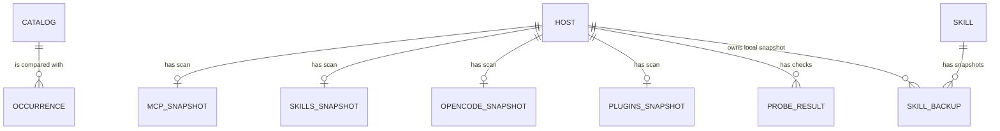
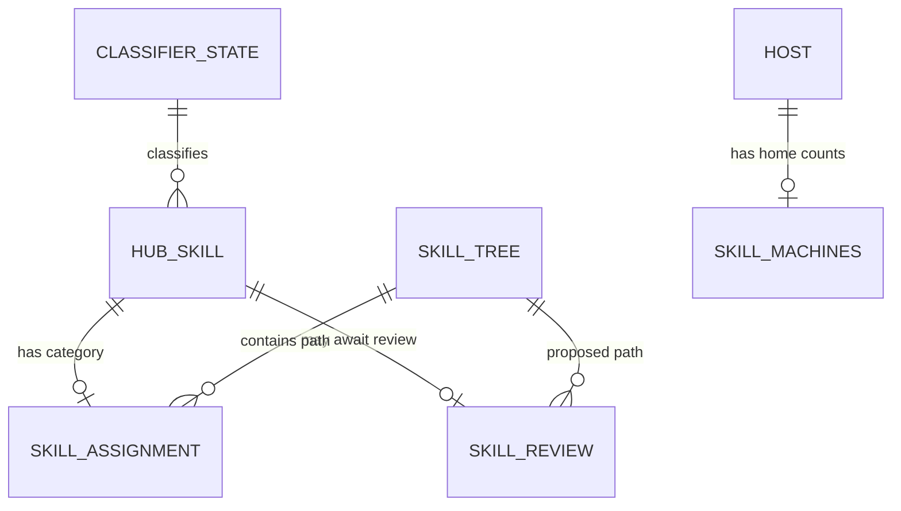

# Agent Tools data model
The plugin stores its catalogue, preferences, probe results, and per-host scan snapshots in BB key-value storage; machine-owned configs and skill archives remain files on their host (`server.ts:522-598`, `host.ts:435-498`).

## Schema overview

The diagram's `OCCURRENCE` is computed from scans, not a persisted collection; catalogue entries and per-host scan families are the persisted inputs (`contract.ts:441-480`, `server.ts:436-463`, `server.ts:601-628`, `host.ts:521-537`).

### Hub skill categories

`HUB_SKILL` is a directory on the BB server, not a KV row. `SKILL_TREE`, `SKILL_ASSIGNMENT`, `SKILL_REVIEW`, and `CLASSIFIER_STATE` are values stored under separate BB KV keys; the ER links show the application relationships, not database foreign keys (`hub-skills.ts:8-12`, `skills-hub-service.ts:201-208`, `skills-hub-service.ts:229-260`).

## BB key-value collections

### Hub skills, categories, and classifier state

The hub library is `<experimental_dataDir>/skills`; the plugin computes each skill's description, byte/file counts, newest modification time, and validation problems by reading the folder (`skills-hub-service.ts:210-223`, `hub-skills.ts:80-105`). The category tree, assignments, review items, classifier state, and per-host homes summary are independent KV values, defaulting to a seeded tree or empty values when absent (`skills-hub-service.ts:201-208`, `skills-hub-service.ts:229-260`, `skills-hub-service.ts:390-410`).

| Entity / key | Field or key | Meaning |
|---|---|---|
| `HUB_SKILL` / folder | `name` | Top-level directory name on the BB server; folder-derived listing skips hidden names and non-directories (`hub-skills.ts:95-105`). |
| `HUB_SKILL` / folder | `description`, `bytes`, `files`, `mtime`, `problems` | Parsed description, measured bytes/files, newest file modification time in milliseconds, and BB validation findings computed on read (`hub-skills.ts:15-22`, `hub-skills.ts:80-92`). |
| `skillTree` | `sections[]` | Category tree stored under the fixed KV key; each section has an ID, Russian/English titles, description and subsection list (`skills-hub-service.ts:202-208`, `categories.ts:7-20`). |
| `skillTree` | `subsections[]` | Child category fields: ID, Russian/English titles and description; IDs are generated from normalized titles (`categories.ts:7-20`, `categories.ts:58-71`). |
| `skillAssignments` | `skill` | Hub skill name; one current assignment is maintained per skill by upsert (`categories.ts:25-33`, `categories.ts:193-204`). |
| `skillAssignments` | `sectionId`, `subsectionId` | IDs of the assigned path in `skillTree`; `locate` verifies the path when assembling the view (`categories.ts:25-33`, `categories.ts:96-104`, `skills-hub-service.ts:424-446`). |
| `skillAssignments` | `source`, `confidence`, `reason`, `at` | Source is `manual`, `family`, or `model`; confidence and reason may be null; `at` is epoch milliseconds (`categories.ts:22-33`, `skills-hub-service.ts:58-73`). |
| `skillReview` | `skill`, `section`, `subsection` | Hub skill name and proposed category labels held for a manual decision (`categories.ts:35-42`, `skills-hub-service.ts:74-82`). |
| `skillReview` | `confidence`, `reason`, `at` | Nullable model confidence/reason and proposal time in epoch milliseconds (`categories.ts:35-42`). |
| `skillClassifier` | `threadId`, `startedAt`, `count`, `running` | Hidden classifier thread ID or null, start time in epoch milliseconds, skills sent in that thread, and persisted run flag (`classifier.ts:37-43`). |
| `skillClassifier` | `lastRunAt`, `lastError`, `lastPlaced` | Last completion time in epoch milliseconds or null, clipped error text or null, and placements in the last run (`classifier.ts:37-56`). |
| `skillMachines` | `hostId`, `hostName`, `homes`, `error`, `at` | Connected host identity, measured skill-home counts/links, per-host error or null, and refresh time in epoch milliseconds (`skills-hub-service.ts:84-90`, `skills-hub-service.ts:390-410`). |

The service reads category data together and serializes writes through a promise lock; category tree, assignments, and review are then persisted as three KV writes (`skills-hub-service.ts:229-256`). The UI and CLI can read the assembled hub view; service handlers write assignments, review, tree, and machine summaries (`skills-hub-service.ts:413-579`).

The hub folder name is its directory key. Category IDs identify section/subsection nodes; assignment and review `skill` names identify their entries by application convention, while classifier state is the singleton value at `skillClassifier` and machine summaries use host IDs (`hub-skills.ts:95-105`, `categories.ts:58-71`, `categories.ts:193-204`, `skills-hub-service.ts:202-208`, `skills-hub-service.ts:390-410`).

| Status-like field | From → to | Function and condition |
|---|---|---|
| `skillClassifier.running` | `false` → `true` | `SkillClassifier.runOnce` persists `running: true` at the start of a run (`classifier.ts:223-226`). |
| `skillClassifier.running` | `true` → `false` | `runOnce` writes false after queue completion or after a caught classifier error (`classifier.ts:254-261`). |
| `skillClassifier.running` | persisted `true` → `false` → active run | `createSkillsHubService` detects the stale flag at startup, clears it, then calls `classifier.run()` (`skills-hub-service.ts:335-343`). |
| `skillReview` membership | unplaced → review | Low confidence or two unanswered model attempts store a review item (`classifier.ts:141-149`, `classifier.ts:285-300`). |
| `skillReview` membership | review → assignment | `acceptReview` ensures its proposed path, writes a manual assignment, and removes the review item (`skills-hub-service.ts:474-492`). |
| `skillAssignments.source` | absent → `family` | `placeByFamily` assigns when the sibling quorum agrees on one existing category (`classifier.ts:175-199`). |
| `skillAssignments.source` | absent or automatic → `model` | `applyModelAssign` stores a validated model placement; existing manual placements are rejected before it runs (`classifier.ts:127-173`, `categories.ts:193-204`). |
| `skillAssignments.source` | any source → `manual` | UI move and review acceptance write manual assignments (`skills-hub-service.ts:458-492`). |
| `skillAssignments.source` | `manual` → automatic source | No transition: `upsertAssignment` preserves manual assignments when the next source is `family` or `model` (`categories.ts:193-204`). |

Assignments and review entries for removed hub skills are pruned at the beginning of classification (`classifier.ts:228-238`, `categories.ts:217-221`). The plugin code has no retention or cleanup job for these KV values; removing a hub skill is separate and moves its folder into the hub-side backup archive (`hub-skills.ts:245-259`, `hub-skills.ts:347-357`).

### `catalog` — desired MCP server definitions

Written by adoption and catalogue update/removal/sync commands; read by overview, drift, and plan (`server.ts:523-525`, `server.ts:1892-1910`, `server.ts:2077-2109`).

| Field | Meaning |
|---|---|
| `name` | Server key; non-empty, maximum 120 characters (`contract.ts:457-467`). |
| `spec` | Normalized MCP definition: transport, command/args/env or URL/headers, and optional disabled state (`contract.ts:5-19`). |
| `scope` | Enum value `global` or `local-only`; adoption chooses the value and `wantsHere` excludes `local-only` (`contract.ts:499-500`, `server.ts:720-723`, `server.ts:1892-1910`). |
| `targets` | Up to 32 agent-kind strings; rollout treats an empty array as all managed kinds (`contract.ts:501-502`, `server.ts:720-723`). |
| `origin` | Nullable `{hostId, kind}` identifying the source machine and CLI for an adopted entry (`contract.ts:503`, `server.ts:1892-1910`). |
| `updatedAt` | Numeric Unix epoch milliseconds; adoption initializes it and catalog update replaces it with `Date.now()` (`contract.ts:504`, `server.ts:1892-1910`, `server.ts:2116-2124`). |

Primary key: `name` by application convention; the schema is an array and adoption appends entries (`server.ts:1892-1910`).

### `ignored` — suppressed pending names

A string array of server names. `ignore` adds names and `unignore` removes them; pending calculation omits ignored names (`server.ts:540-541`, `server.ts:706-746`, `server.ts:2065-2076`). The key is the fixed KV key `ignored`; there is no separate row ID.

### `snapshot:<hostId>` — MCP host scan

One record per BB host ID. `Snapshot` stores `hostId`, `hostName`, nullable `scan`, nullable `error`, and `at`; timestamps are Unix epoch milliseconds (`server.ts:450-456`, `server.ts:596-604`). On host-call failure, `scan` remains null and `error` receives the failure text. On success, `scan` contains `hostname`, `platform`, `home`, nested `scannedAt`, `agents`, and `otherClis` (`server.ts:596-604`, `contract.ts:40-48`). Each agent record has `kind`, `label`, `installed`, `binPath`, `configPath`, `configExists`, `writable`, `gateway`, `servers`, and `warning` (`contract.ts:25-37`). Each server has `name`, `transport` (`stdio`, `http`, `sse`), optional `command`, `args`, `env`, `url`, `headers`, and `disabled` (`contract.ts:5-21`). Each extra CLI record has `bin` and `path` (`server.ts:111-112`, `host.ts:812-823`). `scanHost` calls the selected host and writes `{hostId, hostName, scan, error, at}` whether the call succeeds or throws; `readSnapshots` loads stored values for overview and planning (`server.ts:596-604`, `server.ts:585-594`, `server.ts:831-843`, `server.ts:1158-1184`). No deletion or expiry path appears in the plugin.

### `skills:<hostId>`, `opencode:<hostId>`, `plugins:<hostId>` — feature scan snapshots

Each record has `hostId`, `hostName`, `scan`, and `at` (`server.ts:458-470`). Skills scan fields include `canonicalPath`, `canonHasGit`, `pluginNames`, and `locations`; each entry has `name`, `kind`, `target`, `hash`, `mtime` in milliseconds, `hasSkillMd`, `bytes` excluding recognized junk for content comparison, `bbBytes` and `bbFiles` measured with junk included, and `junk` indicating a recognized junk directory (`contract.ts:74-112`, `host.ts:405-418`, `skill-tree.ts:32-70`). Connected-host scans write these records and the skills view reads them (`server.ts:618-626`, `server.ts:831-900`). The plugin also maintains a derived mirror under the BB server process's `experimental_dataDir/skills`; it is not the enrolled machine's `~/.bb/skills` home (`server.ts:1361-1383`, `skills-server.ts:58-64`). If a canon skill is absent from the server process's local canon, the rollout can select a connected host canon, call `skills_archive`, and extract the base64 tar into that process directory. The host packs recognized-junk exclusions and refuses archives over 8 MiB; extraction removes the temporary tar even if `tar` fails (`server.ts:1412-1453`, `server.ts:1488-1503`, `host.ts:1086-1115`, `skills-server.ts:130-145`). OpenCode and CLI-plugin scan shapes remain as defined in their contracts (`contract.ts:193-206`, `contract.ts:255-292`). Optional OpenCode and plugin scans catch failures, log a warning, and leave any prior value in storage untouched (`server.ts:628-638`, `server.ts:640-648`).

### Scalar and bounded-value keys

| KV key | Meaning / fields | Writer and readers |
|---|---|---|
| `lang` | `ru` or `en`; defaults to `en` when absent or unsupported (`server.ts:488-490`, `i18n.ts:6-17`). | `set_language` writes the key; plugin initialization reads it before defining setting labels (`server.ts:2201-2205`, `server.ts:488-490`). |
| `autoSync` | Boolean scheduled MCP sync toggle; absent means false (`server.ts:580-581`). | Setter writes the switch; the scheduled sweep reads it before sync (`server.ts:2296-2302`, `server.ts:2306-2317`). |
| `lastScanAt`, `lastSyncAt` | Unix epoch milliseconds for the most recent all-host scan and sync (`server.ts:650`, `server.ts:1686`). | Scan/sync orchestration writes; overview reads (`server.ts:1126-1127`). No expiry shown. |
| `probes` | Probe result array keyed by `(hostId, kind, name)` when replacing prior values; fields are `kind`, `name`, `ok`, `tools`, `error`, `durationMs`, and `checkedAt` (epoch milliseconds) (`contract.ts:156-164`, `server.ts:1919-1925`). | Probe writes; overview and CLI read. The merged array is truncated to the latest 400 records (`server.ts:1919-1925`, `server.ts:2673-2689`). |
| `metamcp` | Cached namespace records with `namespace`, `url`, `servers` (`name`, tool count), `error`, and `fetchedAt` (epoch milliseconds) (`server.ts:631-649`, `metamcp.ts:5-17`). | Gateway refresh; overview reads to preserve data across plugin reloads (`server.ts:631-649`). |

### BB settings

Settings are declared through `bb.settings.define`, outside the plugin KV keys (`server.ts:473-516`). Fields: `metamcpUrl` (string), `metamcpApiKey` (secret string), `metamcpNamespaces` (comma-separated string, default `secondary`), `skillsFanOutAuto` (boolean, default false), `skillsFanOutPluginNames` (boolean, default true), and `skillsSyncRemote` (secret string). `readConfig` reads values at use time (`server.ts:517-520`).

## Host filesystem data

### CLI configuration files

`agents.ts` maps each supported agent kind to a home-relative file, JSON/JSONC/TOML format, config pointer, and dialect (`agents.ts:16-25`, `agents.ts:56-219`). The host reads these files, merges only modeled fields, and rewrites entries during apply (`host.ts:151-210`, `normalize.ts:194-203`, `host.ts:1118-1189`). Backups are adjacent `<file>.bak-bb-mcp-<timestamp>` files; only five are retained, and temp-file rename preserves permissions (`host.ts:213-241`).

### Skill homes, fan-out state, and archive

The scan reads `~/.agents/skills`, Claude, Codex, Gemini, BB, OpenCode, Cursor, and Qwen locations (`host.ts:254-273`). Each entry holds name, kind, target, hash, mtime, and `hasSkillMd`; it also reports content bytes, BB-counted bytes and files, and whether recognized junk directories are present (`host.ts:389-435`, `contract.ts:99-105`). The BB tree measure counts regular files and bytes including junk, records up to five symlink/junk paths, and stops traversal after its scan guard (`skill-tree.ts:32-70`). `~/.agents/skills-fanout.json` stores top-level `at` (ISO timestamp) and `entries[name] = { hash, mirrored? }`, recording previously managed BB mirrors (`skills.ts:342-345`, `skills.ts:507-524`, `host.ts:283-293`, `host.ts:966-975`).

The BB server process keeps user skills under `bb.server.experimental_dataDir/skills`; Agent Tools plans and applies mirrors there separately from host homes. Host archives sent for missing canon entries are base64 tar content with junk excluded and an 8 MiB packed-size ceiling; this payload is transient RPC data rather than a persisted catalogue row (`server.ts:1361-1532`, `skills.ts:582-612`, `host.ts:1086-1115`, `skills-server.ts:58-64`, `skills-server.ts:130-145`).

Skill snapshots live below `~/.agents/skills-backups/<name>/<timestamp>/` with `.backup.json` metadata fields `name`, ISO timestamp `at`, `reason`, `locationId`, `machine`, and content hash (`host.ts:299-315`). The archive reader derives `files`, `bytes`, and `unique` on read (`host.ts:982-1039`). Restore writes snapshot content to the canon and archives current canon content first (`host.ts:1041-1061`). The code has no skill-backup retention cleanup; the reader returns at most 500 rows (`host.ts:982-1039`).

### OpenCode configuration

OpenCode provider/model state is read from `~/.config/opencode/opencode.json` or `opencode.jsonc`; provider fields include ID, display name, package, base URL, API-key-present flag, models, allowlist, and raw provider config (`host.ts:790-851`, `contract.ts:181-206`). JSONC with comments is read-only (`host.ts:802-813`, `host.ts:669-671`). File writes use the same adjacent backup and atomic-write helper (`host.ts:686-697`, `host.ts:435-463`).

### BB SQLite preference row

The plugin directly reads/writes the `project_execution_defaults` table in BB's `~/.bb/bb.db` for provider `acp-opencode`. It reads the model from the row with the greatest `updated_at`; writes update rows or insert one with model, provider, service tier, reasoning level, permission mode, and update timestamp (`server.ts:738-775`). This plugin does not define the table schema. The selection query reads `projects.id` to associate a newly inserted row (`server.ts:766-770`).

## Lifecycle and retention

| Data | Transition / writer | Cleanup |
|---|---|---|
| Catalogue row | Pending adoption → global/local-only; update → changed fields; remove/forget → catalogue row deleted (`server.ts:1691-1710`, `server.ts:1877-1901`). | No age-based cleanup. `forget` leaves host configs unchanged (`server.ts:2365-2375`). |
| MCP snapshots | `scanHost` stores each selected host result, with `error` on host-call rejection (`server.ts:596-604`). | No plugin cleanup path. |
| Probe results | New result replaces same host/kind/name; newest combined list is truncated to 400 (`server.ts:1681-1688`). | Older probe records beyond that limit are dropped. |
| Config backups | Created before writes; sorted and oldest beyond five are deleted (`host.ts:435-448`). | Keep last five per config file. |
| Skill backups | Created before replacement/deletion; list computes uniqueness and sizes (`host.ts:521-537`, `host.ts:982-1039`). | No cleanup job in this code. |

See [MCP catalogue](features/mcp-catalog.md), [legacy skills rollout](features/skills.md), [hub skills and categories](features/skills-hub.md), and [OpenCode](features/opencode.md).

<!-- lane-pilot:backlinks -->
## Referenced by

- [Plugin RPC and Skills page runtime](api-runtime.md)
- [Agent Tools architecture](architecture.md)
- [MCP server catalogue](features/mcp-catalog.md)
- [OpenCode provider and model management](features/opencode.md)
- [Agent skill canon and rollout](features/skills.md)
- [Agent Tools gotchas](gotchas.md)
- [Agent Tools overview](overview.md)
